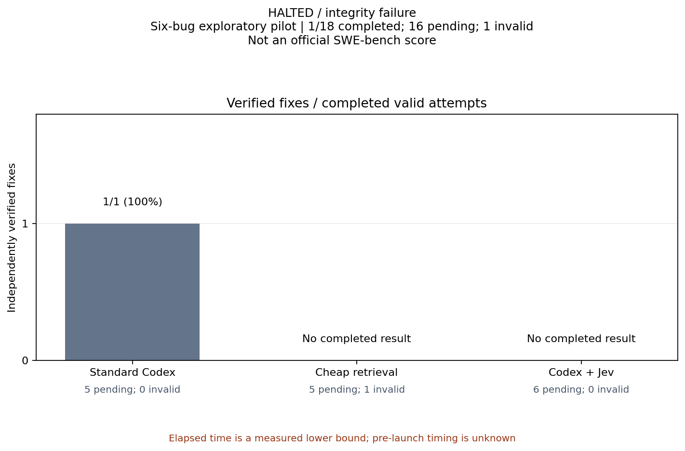

# Halted whole-plugin pilot: actual partial outcomes

These are real native Codex task observations, not synthetic grader controls. The study stopped after an orchestration error broke isolation. They cannot establish whether Jev helps.

| Condition | Native launches | Valid completed attempts | Verified fixes | Invalid | Unstarted |
| --- | ---: | ---: | ---: | ---: | ---: |
| Standard Codex | 1 | 1 | 1 | 0 | 5 |
| Cheap retrieval | 1 | 0 | unknown | 1 | 5 |
| Codex + Jev | 0 | 0 | unknown | 0 | 6 |

The Standard Codex patch passed the frozen hidden grader once in an independent clean checkout. The cheap-retrieval launch received a shell error as its prompt because the coordinator failed to check a prerequisite command's exit status. It read the source chat while trying to recover and made no code changes. It is retained as an invalid consumed attempt, not a coding-model failure. No replacement or Jev attempt was started.

The source and task settings were GPT-6.1 Sol / Ultra, one pinned Requests bug, independent Git histories, and the previously qualified grader. The exact internal model version is unknown. Baseline component absence is a native startup-agent observation and the absence of Jev markers in retained developer context; a private dispatcher inventory was unavailable.

Baseline elapsed time includes coordinator recovery delays and overlap. The invalid launch has only a measured 54-second native-runtime lower bound; pre-launch timing was not recorded. Unknown billing remains unknown. No causal speedup, savings, general superiority, official SWE-bench score, or completed eighteen-attempt screen is claimed.

The immutable original study remains halted. A separately approved amendment is required to execute the sixteen unstarted slots without replacing the invalid one. Claude, QQ, previous cohorts, automatic model routing and stable release promotion remain held.

Downloads: [JSON](report.json), [summary CSV](summary.csv), [paired outcomes CSV](paired.csv), [elapsed curve CSV](curves.csv), [fixes SVG](charts/verified-fixes.svg), [elapsed SVG](charts/cumulative-fixes.svg).

All four chart pairs are in [charts](charts). Raw native transcripts, local identities, account data, reference solutions and grader internals remain private. The public report contains aggregate observed counts and usage only.
