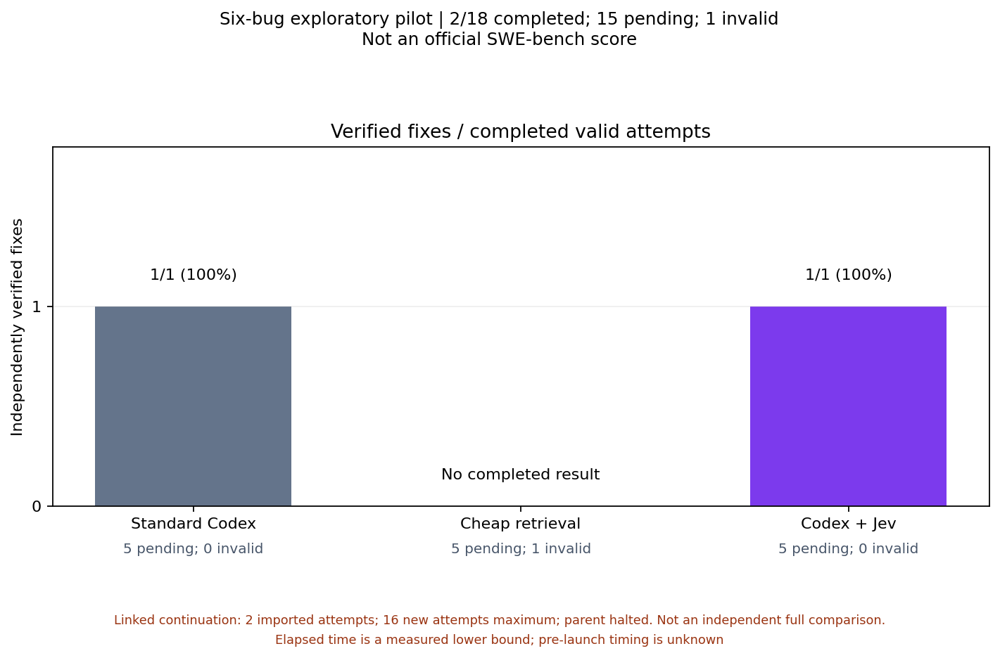

# First actual bug comparison: fifteen attempts pending

Requests2931, GPT-6.1 Sol / Ultra, the same frozen source and coding instructions. Both retained coding patches passed the unchanged hidden grader once in separate clean checkouts.

| Condition | Verified fixes / valid completed attempts | Invalid | Remaining |
| --- | ---: | ---: | ---: |
| Standard Codex | 1 / 1 | 0 | 5 |
| Cheap retrieval | No valid result | 1 | 5 |
| Codex + Jev | 1 / 1 | 0 | 5 |

This is a tie in observed correctness on one bug. It does not demonstrate a quality improvement. Fifteen original slots remain. The invalid cheap launch is retained; it is not a coding-model failure and will not be replaced.

The Jev attempt delivered 41 consultations: 27 abstentions and 14 assessed responses. All 41 have independently joined validated HTTP200 transport receipts and provider request IDs. Two concrete returned strategies were followed by matching actions; the coding agent had proposed those alternatives beforehand, so observed uptake is not evidence of incremental causal benefit. Uptake of the other 39 responses is unknown. Neither valid coding attempt incurred an observed approval interruption. Billed dollars remain unknown.

This explicitly approved linked continuation imports the two consumed original records, permits only sixteen new attempts and preserves the halted parent unchanged. The original screen remains inconclusive. Baseline elapsed time includes coordinator recovery delays/overlap; invalid cheap startup timing is missing. Curves retain these limitations and must not be used to claim a speedup. This is a six-bug exploratory pilot with a focused frozen grader, not an official full SWE-bench score or full upstream regression suite.

Downloads: [JSON](report.json), [summary CSV](summary.csv), [paired outcomes CSV](paired.csv), [elapsed curves CSV](curves.csv), [fix-count SVG](charts/verified-fixes.svg), [elapsed SVG](charts/cumulative-fixes.svg). All four PNG/SVG chart pairs are in [charts](charts).

Raw traces, provider IDs, local account/workspace identities and grader internals remain private. No confirmation study, feature tuning, Claude inference, QQ work, automatic model routing or stable promotion is authorized by this result.
